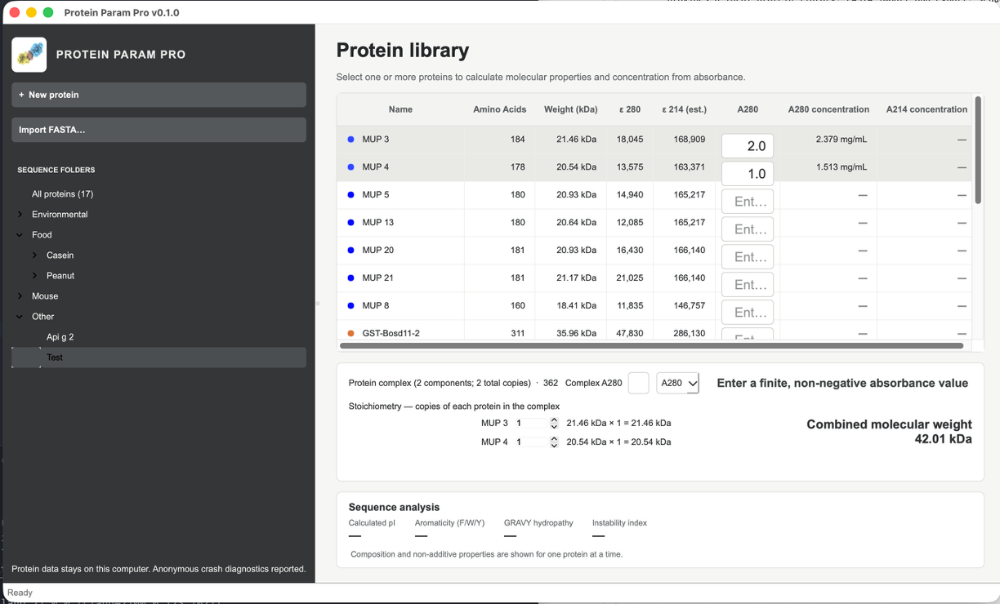

# Protein Param Pro

Protein Param Pro is a desktop application for organizing protein sequences and calculating commonly used molecular properties. It provides a local protein library, FASTA import and export, sequence-level analysis, and concentration estimates from absorbance measurements in a PySide6 interface.

## Features

- Store protein names, one-letter amino-acid sequences, folders, colors, and notes.
- Organize proteins in collapsible, nested folders and rearrange them with drag and drop.
- Import one or more sequences from `.fasta`, `.fa`, or `.faa` files.
- Export one protein, selected proteins, a folder, or the complete library as FASTA.
- Export calculated properties and library metadata as CSV.
- Calculate sequence length, molecular weight, and extinction coefficients at 280 nm and an estimated 214 nm.
- View calculated isoelectric point, aromaticity, GRAVY hydropathy, instability index, and the count and percentage of every standard amino acid.
- Estimate protein concentration in µM and mg/mL from an A280 or A214 measurement.
- Select multiple proteins to calculate the combined mass, extinction coefficient, and concentration of a 1:1 complex.

Protein Param Pro accepts the 20 standard one-letter amino-acid codes. Whitespace and `*` stop characters are removed automatically when a sequence is saved or imported.



## Using the application

Create a protein with **New protein**, or use **Import FASTA** to add several records at once. Select a folder in the sidebar to filter the table, and drag proteins or folders in the tree to reorganize the library.

Select a protein to see its sequence analysis. Double-click the analysis panel, or right-click a protein and choose **View sequence analysis**, for the complete amino-acid composition. Double-click a table row to edit its details and notes.

Enter each protein’s absorbance in its table row; values are saved with the record. Both individual concentration columns use that row’s value with the corresponding A280 or A214 extinction coefficient. Selecting one protein shows its saved absorbance and concentration at the chosen wavelength below the table. With multiple proteins selected, enter a separate measured absorbance in the lower calculator for the complex. Switching between A280 and A214 keeps the entered absorbance and changes the extinction coefficient used for the calculation. Calculations assume a 1 cm path length. Use the stoichiometry spinboxes below the calculator to set the number of copies of each selected protein (default: one). The complex calculation weights the mass and extinction coefficient by these counts for both A280 and A214. Counts are retained while the app is open; individual protein records and their saved absorbance values are unchanged.

Right-click proteins or folders for export, color, rename, and delete options. CSV export includes the sequence, notes, folder, calculated properties, and amino-acid composition.

## Installation from source

Protein Param Pro requires Python 3.14.5 or newer.

```bash
git clone https://github.com/gageoleighton/Protein-Param-Pro.git
cd Protein-Param-Pro
python3 -m venv .venv
source .venv/bin/activate
python -m pip install -r requirements.txt
python src/main.py
```

On Windows, activate the environment with `.venv\Scripts\activate` before running `python src/main.py`.

## Building the macOS application

The included PyInstaller specification builds the standalone macOS application bundle:

```bash
source .venv/bin/activate
pyinstaller ProteinParamPro.spec
```

The resulting application is written to `dist/ProteinParamPro.app`. The current specification targets the architecture of the Mac used for the build and does not configure code signing or notarization.

### Running an unsigned build

Because the application is not currently signed or notarized, macOS may report that it cannot verify or open the downloaded app. Only if you obtained the application from the GitHub Releases page, remove its quarantine attributes in Terminal:

```bash
xattr -cr "ProteinParamPro.app"
```

You should then be able to open Protein Param Pro normally. You may need to repeat this step after downloading a newer unsigned build.

## Data and privacy

The protein library and interface state are stored locally in `~/.protein_param_pro/`:

- `sequences.json` contains protein sequences and their associated metadata.
- `ui_state.json` remembers collapsed folders.

When a Sentry DSN is supplied in `sentry_config.json` or the `SENTRY_DSN` environment variable, the application sends crash diagnostics to help identify bugs. Error reporting disables default personally identifiable information, local-variable capture, and performance tracing. Remove the DSN or leave it unset to disable reporting. Protein library data is not uploaded as part of the application's normal operation.

## Calculation notes

- Molecular weight is calculated from the average residue masses plus one water molecule.
- The A280 extinction coefficient uses 5,500 M⁻¹ cm⁻¹ per tryptophan, 1,490 M⁻¹ cm⁻¹ per tyrosine, and 125 M⁻¹ cm⁻¹ per cysteine.
- The A214 extinction coefficient is an approximation of 923 M⁻¹ cm⁻¹ per peptide bond.
- Isoelectric point, aromaticity, GRAVY, and instability index calculations use [Biopython](https://biopython.org/).

These values are computational estimates and should be checked against an appropriate experimental method before critical use.

## Built with

- [Biopython](https://biopython.org/) for protein sequence analysis
- [PySide6](https://doc.qt.io/qtforpython-6/) for the desktop interface
- [PyInstaller](https://pyinstaller.org/) for application packaging
- [Sentry](https://sentry.io/) for error reporting

## Support

Report problems through the [GitHub issue tracker](https://github.com/gageoleighton/Protein-Param-Pro/issues) or contact Gage O. Leighton, PhD at gageoleighton at gmail.com.

### Sequence features

The protein editor highlights supported motifs as you type. Its **Features** tab lists the name, type, start, end, length, and matched sequence. The sequence analysis window also includes **Sequence** and **Features** tabs. Highlight colors match the feature table; matches use color only until hovered or selected. Selecting a feature row selects that range in the sequence; switch to Details or Sequence to view it.

Coordinates are 1-based and inclusive in the normalized sequence (whitespace and `*` are excluded). Repeated and overlapping matches are listed separately; a continuous run of six or more histidines is listed once. Detection does not modify sequences or exclude tags from property calculations.

Supported motifs: His (6+ consecutive H), FLAG (`DYKDDDDK`), HA (`YPYDVPDYA`), Myc (`EQKLISEEDL`), V5 (`GKPIPNPLLGLDST`), TEV (`ENLYFQ` followed by S/G/A/M/C/H), thrombin (`LVPRGS`), and enterokinase (`DDDDK`). These are potential sequence matches, not confirmed functional annotations. Protease coordinates cover the recognition motif, not the cleavage bond. MBP and GST fusion tags are also detected using full reference sequences at ≥95% identity (see below). Other large fusion domains, signal peptides, and variants below the identity threshold are not predicted. Overlaps may be coincidental, such as the enterokinase motif within FLAG.

Motif references: [Addgene protein tags](https://blog.addgene.org/plasmids-101-protein-tags), [NEB TEV protease](https://www.neb.com/en-gb/products/p8112-tev-protease), and [UNC protease recognition sequences](https://bowerslab.web.unc.edu/wp-content/uploads/sites/10024/2019/11/PROTEASES.pdf).

Run feature checks with `PYTHONPATH=src python -m unittest discover -s tests`.

A scrollable **Feature legend** beside the sequence lists only features detected in the current sequence, with one entry per feature type. Hover over an entry to underline all corresponding sequence regions; moving away removes that emphasis. Selected sequence text is also underlined, including ranges selected through the Features table. Font weight and text spacing stay unchanged. The legend updates as the sequence is edited. It is available in both the protein editor and the analysis Sequence tab.

**MBP/GST detection:** MBP matches the complete mature E. coli chain, residues 27–396 of [UniProt P0AEX9](https://www.uniprot.org/uniprotkb/P0AEX9/entry). GST matches residues 2–218 of the common S. japonicum tag, [UniProt P08515](https://www.uniprot.org/uniprotkb/P08515/entry). Both require ≥95% identity across the full reference core and allow an additional initial methionine and can occur anywhere in a fusion, including repeated tags. The complete matched range is highlighted. MBP's native signal peptide is not part of the reported mature tag. These full-length matches allow substitutions up to the identity threshold; insertions, deletions, and truncated tags are not supported. Other species are detected only if their sequence meets the same threshold. Reference sequences are bundled; detection works offline.


Additional short tags use these reference sequences:

| Tag | Recognized sequence |
| --- | --- |
| AviTag | `GLNDIFEAQKIEWHE` |
| Strep-tag II | `WSHPQFEK` |
| Twin-Strep | `WSHPQFEKGGGSGGGSGGSAWSHPQFEK` |
| T7 | `MASMTGGQQMG` |
| S-tag | `KETAAAKFERQHMDS` |

Twin-Strep detection covers the standard 28-residue core, excluding any preceding SA extension. Its two Strep-tag II motifs are also listed, following the existing overlapping-feature behavior. Substitutions, including within the Twin-Strep linker, are allowed only within the 95% identity threshold; alternate-length linkers are not inferred. AviTag detection identifies the sequence, not whether it has been biotinylated.

References: [Avidity AviTag](https://www.avidity.com/), [IBA Strep/Twin-Strep sequences](https://www.iba-lifesciences.com/media/5d/ef/a7/1686569911/DS_2-1567_StrepMAB-Immo_DY-549.pdf), [Merck T7 tag](https://www.sigmaaldrich.com/deepweb/assets/sigmaaldrich/marketing/global/documents/257/330/recombinant-tool-mk.pdf), and [Merck S-tag](https://www.merckmillipore.com/deepweb/assets/sigmaaldrich/marketing/global/documents/375/911/protein-purification-tag-fl9869en-ms.pdf).


### Tag variants and sequence identity

Fixed tag references are matched at **≥95% sequence identity**, calculated as `100 × matching residues / reference length` over a full-length, ungapped window. This is sequence similarity, not a statistical confidence estimate. The Features table shows **Identity** and **Substitutions**, and displays the actual observed sequence. Colors, legend hover, and feature coordinates also work for variant matches.

The allowed substitution count is rounded down: mature MBP (370 residues) allows 18; GST core (217) allows 10; Twin-Strep (28) allows 1. AviTag (15) and other tags shorter than 20 residues require exact matches at this threshold. The optional initial methionine on MBP/GST is included in highlighted coordinates when present but excluded from core identity scoring. Protease motifs and variable His runs keep their original detection rules. Insertions, deletions, and partial-domain matches are not aligned or inferred.
